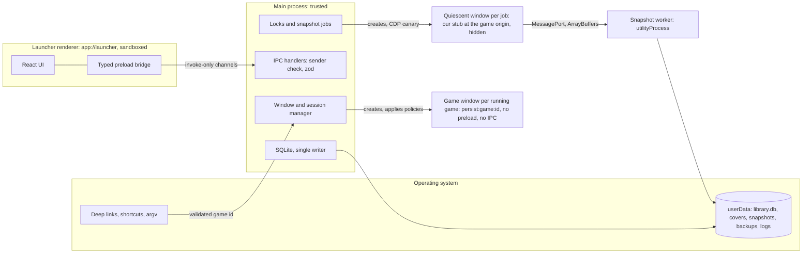
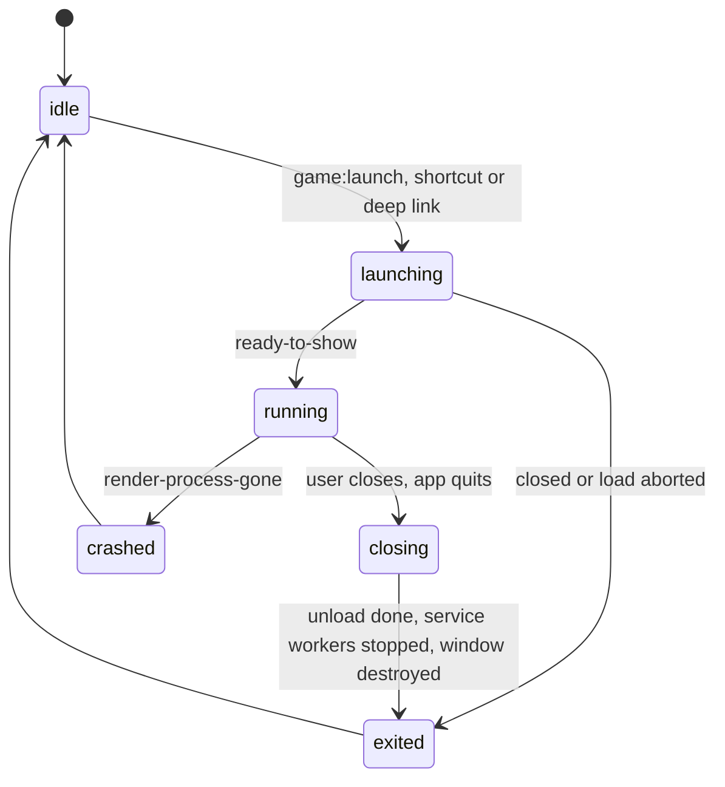

# Architecture of the desktop client

Status: draft for Phase 1, 2026-10-25. Normative for `apps/desktop` and the shared packages. Product requirements are in
the [PRD](../product/prd.md) (features `F-n`, acceptance criteria `AC-n`, open questions `OQ-n`); this spec does not
repeat them, it says how they are built. Runtime: Electron 45 ([ADR-0002](../adr/0002-desktop-runtime.md), desktop
runtime), accepted by the owner with one condition: H7 frame time is re-measured in Phase 1 on the launcher against
Chrome. `Owner` (decision of 2026-10-25). The evidence is the spike,
[RESULTS.md](../../spikes/runtime-compat/RESULTS.md). Related: [snapshot-format.md](snapshot-format.md), [save-transfer.md](save-transfer.md), [security.md](security.md).
Conventions (MUST, claim tags, `Assumed` for calls made here) are those of
[snapshot-format.md](snapshot-format.md#conventions).

## 1. Process model and trust boundaries



| Process | Trust | Owns | Never |
| --- | --- | --- | --- |
| Main | Trusted | Windows, sessions and their policies, IPC, locks, the SQLite database (only writer), the OS integration | Runs code from a game, snapshot or deep link (AGENTS.md security invariant 7) |
| Launcher renderer | Semi-trusted (our code, renders untrusted strings) | React UI on `app://launcher` | Gets Node, file paths or generic IPC |
| Game window | Untrusted | The game page, one window per running game | Gets a preload, IPC, Node or the launcher's session (invariants 1 and 2) |
| Quiescent window | Our code in the game's origin | Export and import for one job | Runs game code (canary, [save-transfer.md](save-transfer.md#5-quiescent-window)) |
| Snapshot worker | Trusted code, untrusted input | Archive validation, encoding, hashing, zstd, files | Writes the database (it reports to main) |

The boundaries and their threats are in [security.md](security.md#2-trust-boundaries). `Owner` for the process split
(plan, design decisions), `Assumed` for the details.

## 2. Module map

| Path | Content | Depends on |
| --- | --- | --- |
| `apps/desktop/main` | App lifecycle, window and session manager, policies (pure, unit-tested functions: URL decisions, permission decision, playtime, badges, window-state guard), IPC handlers, SQLite access and migrations, locks, jobs, deep links, shortcuts, logs; a second build entry for the snapshot worker | `packages/shared`, `packages/snapshot` |
| `apps/desktop/preload` | Two bundles: the launcher bridge and the quiescent preload (built from `packages/exporters`) | `packages/shared`, `packages/exporters` |
| `apps/desktop/renderer` | React UI | `packages/shared` (types only) |
| `packages/shared` | Types, zod schemas, the IPC contract, error codes, id helpers | none |
| `packages/snapshot` | The `.wgsnap` codec (pure TypeScript, Web APIs only), limits, golden vectors | none |
| `packages/exporters` | Generic exporter and importer, inventory, declarative adapters and their schema | `packages/snapshot`, `packages/shared` |

None of these exists yet; each is created with the Phase 1 work that needs it (AGENTS.md, no empty artifacts). Build
and packaging tools are ADR-0004 (toolchain and repository layout). `Assumed`

## 3. On-disk layout

```text
<userData>/
  library.db, library.db-wal, library.db-shm
  covers/<gameId>-<random>.<png|jpg|webp>
  snapshots/<gameId>/<revisionId>.wgsnap      exports and imported files, immutable
  backups/<gameId>/<revisionId>.wgsnap        pre-import and pre-delete backups, never deleted automatically
  backups/library-v<n>-<time>.db              database copy before a schema migration
  tmp/                                        *.partial files; emptied at start-up
  logs/main.log                               redacted, rotated (5 files of 5 MiB)
  Partitions/...                              Chromium's per-partition data
```

- Chromium's partition directories are never read, copied or deleted by our code; storage is reached only through
  browser APIs (AGENTS.md data-safety invariant 1). How Electron names them on disk is Unverified and irrelevant.
- Files are written as `.partial` in `tmp/`, flushed with `fsync`, then renamed into place, so a crash never leaves a
  half-written snapshot or backup under its final name. `Assumed`

## 4. Game session lifecycle



- **One window per game.** A launch while the game is `launching`, `running` or `closing` focuses that window (shows and
  restores it if minimized) instead of opening another (F-5). `Owner` for the session, `Assumed` for the focus rule.
- **Per-game lock** in the main process: `none`, `session` (any state but `idle`), `task` (export, import, delete local
  saves, clear cache) or `needs_recovery`. A launch is refused with `GAME_BUSY` or `NEEDS_RECOVERY` while a task or a
  recovery holds it; a task is refused with `GAME_RUNNING` while the session holds it (AC-11). `Assumed`
- **Close procedure (MUST, AC-13, spike finding H16).** A closed window's renderer lived 27.8 s, until the game's service
  worker stopped. Verified (2026-10-24, RESULTS.md H16). Electron 45 has no API to stop a service worker: `ServiceWorkers`
  offers `getAllRunning`, `getInfoFromVersionID`, `getWorkerFromVersionID` and `startWorkerForScope`. Verified
  (2026-10-25, `electron.d.ts` in the `electron@45.0.0` package). The experimental CDP domain `ServiceWorker` has
  `stopAllWorkers` and `stopWorker(versionId)`. Verified (2026-10-25,
  <https://raw.githubusercontent.com/ChromeDevTools/devtools-protocol/master/pdl/domains/ServiceWorker.pdl>).
  `BrowserWindow.destroy()` skips `beforeunload` and `unload`. Verified (2026-10-25, same `electron.d.ts`). So, on the
  window's `close` event the main process MUST:
  1. prevent the default close, hide the window and stop playtime;
  2. load `about:blank` in the same `webContents`, so that the game's `beforeunload`, `pagehide` and `unload` handlers
     run and can save (a `will-prevent-unload` asks the user with a native dialog; on "Stay" the window is shown again
     and the game keeps running);
  3. attach `webContents.debugger`, send `ServiceWorker.enable` and `ServiceWorker.stopAllWorkers`, and wait until
     `session.serviceWorkers.getAllRunning()` is empty, at most 2 s; if any remains, send `ServiceWorker.stopWorker` for
     each version id and log `SW_STOP_FAILED` if that does not help;
  4. destroy the window and record `exited`.

  That this works through `webContents.debugger` in Electron 45 and covers the whole session is Unverified; the AC-13
  e2e test (process list before, with the game open, 5 s after close and 5 s after quit) MUST pass before AC-13 is
  claimed. App quit runs the same procedure for every open game window in parallel, at most 3 s, then quits; 5 s after
  quitting no process of the bundle remained in the spike. Verified (2026-10-24, RESULTS.md H16).
- **Crash and hang.** `render-process-gone` ends the session as `crashed` and the library shows it; `unresponsive`
  offers "Force close", which uses `webContents.forcefullyCrashRenderer()`. `Assumed`

## 5. Game windows and sessions

- **Window factory (AC-3).** A pure function returns the game window's `webPreferences`: `partition:
  "persist:game:<gameId>"`, `sandbox: true`, `contextIsolation: true`, `nodeIntegration: false`,
  `nodeIntegrationInWorker: false`, `nodeIntegrationInSubFrames: false`, `webSecurity: true`,
  `allowRunningInsecureContent: false`, `experimentalFeatures: false`, no `enableBlinkFeatures`, `webviewTag: false`,
  `spellcheck: false`, `safeDialogs: true`, `navigateOnDragDrop: false`, and no `preload`. Its unit test asserts every
  value. `Owner` (AGENTS.md security invariant 1), `Assumed` for the extra hardening keys.
- **Session setup.** One function, `gameSession(gameId)`, is the only way to obtain a game session; on first use it
  installs the permission request and check handlers, the device, HID, serial, USB and Bluetooth refusals, the download
  refusal, and turns the spell checker off. `app.on("session-created")` installs deny-all handlers on every session as a
  baseline, and `app.on("web-contents-created")` refuses `<webview>` attachment and new windows by default. The
  decisions themselves are tables in [security.md](security.md#5-permission-and-navigation-policy) (AC-4, AC-5).
- **Same-site decisions** use one function `siteOf(origin)` (scheme plus registrable domain from the Public Suffix List;
  the host itself for IP addresses and `localhost`). The PSL dependency is chosen in Phase 1 under the dependency
  policy. `Assumed`
- **Storage partitioning stays on.** Playwright's Electron loader appends `ThirdPartyStoragePartitioning` to
  `--disable-features`, which makes a cross-site iframe share storage with the top level; re-appending the list without
  that entry in the main process restores partitioning. Verified (2026-10-24, RESULTS.md H11). The app MUST do this at
  start-up whenever the switch contains that entry, in every build, because partitioning is what the storage keys of
  snapshots assume. `Assumed` for the rule. Implemented as `fixPartitioningSwitch` in `apps/desktop/src/main/start-up.ts`;
  the e2e test "cross-site iframe storage stays partitioned under Playwright" (`apps/desktop/e2e/launcher.spec.ts`)
  shows a cross-site progress-lab iframe in its own empty partition under `_electron.launch`, and with the fix removed
  the same test fails because the iframe sees the top-level progress. Verified (2026-10-28, Electron 45.0.0,
  Playwright 1.64.1, macOS arm64). Playwright adds that loader only when `_electron.launch` gets no `executablePath`.
  Verified (2026-10-28, `coreBundle.js` of `playwright-core` 1.64.1).
- **Frames are recorded.** `did-frame-navigate` with an http or https URL adds `(top origin, frame origin)` to
  `storage_targets` ([save-transfer.md](save-transfer.md#2-storage-keys)).

## 6. IPC contract

Launcher renderer to main, invoke-only (`ipcRenderer.invoke` / `ipcMain.handle`). No generic `send` or `invoke` is
exposed: the preload offers one typed function per channel and two event subscriptions. Electron 45 sandboxed preloads
no longer have `Buffer`, `events`, `timers` or `url`, so the bridge uses none of them. Verified (2026-10-24,
<https://releases.electronjs.org/release/v45.0.0>).

| Channel | Request | Response `data` |
| --- | --- | --- |
| `library:list` | `{}` | Cards: id, title, url, cover URL, badges, last launch, playtime, session state |
| `library:add` | `{url, title?}` | The new card (rules in section 12) |
| `library:update` | `{gameId, title?, cover?: "pick" \| "remove"}` | The card; `pick` opens the file dialog in main |
| `library:remove` | `{gameId}` | `{}` (section 12) |
| `library:orphans`, `library:deleteOrphanData` | `{}`, `{gameId}` | Orphan list; `{taskId}` |
| `game:launch`, `game:focus` | `{gameId}` | `{state}`, `{}` |
| `game:clearCache`, `game:deleteSaves` | `{gameId}` | `{}`, `{taskId}` |
| `snapshot:export` | `{gameId, frameKeys?}` | `{taskId}` |
| `snapshot:import` | `{gameId, source: {revisionId} \| "file", mapping?: [{from, to}]}` | `{taskId}`; `"file"` opens the file dialog in main |
| `snapshot:list` | `{gameId}` | Snapshot rows (section 7) |
| `snapshot:verify` | `{gameId, revisionId}` | `{taskId}` |
| `snapshot:saveAs` | `{gameId, revisionId}` | `{saved}`; save dialog in main |
| `shortcut:create` | `{gameId}` | `{created}`; save dialog in main |
| `settings:get`, `settings:set` | `{}`, a partial object of allowlisted keys | Settings |

Main to the launcher renderer only: `game:state {gameId, state, at}` and `task:progress {taskId, gameId, kind, step,
status: "running" | "done" | "failed", bytesDone?, bytesTotal?, code?}`. Progress reports real steps and measured bytes
only; a percentage appears only when `bytesTotal` is known (AGENTS.md honesty rule 1).

- **Sender check, every handler:** `event.sender` is the launcher window's `webContents`, `event.senderFrame` is its main
  frame, and the frame URL's origin is `app://launcher`. A failing call is rejected without detail and logged once as
  `IPC_FORBIDDEN_SENDER`. `Owner` (AGENTS.md security invariant 6), `Assumed` for the exact test.
- **Validation:** every payload passes a strict zod schema (`packages/shared`); unknown keys are rejected; serialized
  payloads above 64 KiB are rejected. Ids must be lowercase UUIDv7.
- **Errors:** `{ok: false, code, message}`; success is `{ok: true, data}`. `message` is short English for the UI with no
  paths, query strings or save data. Codes: `INVALID_ARGUMENT`, `NOT_FOUND`, `URL_NOT_ALLOWED`, `GAME_RUNNING`,
  `GAME_BUSY`, `NEEDS_RECOVERY`, `CANCELLED`, `INTERNAL`, and the `SNAP_*`, `EXP_*` and `IMP_*` codes of the other specs.
- **No paths cross IPC.** The renderer never sends a file path or an arbitrary URL to open; files are chosen in native
  dialogs owned by main, and destructive actions (remove, delete local saves, import, a storage-key mapping) are confirmed
  in a native dialog whose text main writes. `Assumed`
- Game windows have no IPC at all; quiescent windows use only the handshake of
  [save-transfer.md](save-transfer.md#5-quiescent-window). Bulk data never travels as JSON IPC (AGENTS.md data-safety
  invariant 9).

## 7. SQLite schema v1

`node:sqlite` in the main process, the only writer (AGENTS.md data-safety invariant 9); the library survives restarts in
this file (AC-1). It worked in the Electron 45 main process and in a `utilityProcess` with WAL, `PRAGMA user_version`,
close and reopen, and no warning. Verified (2026-10-24, RESULTS.md H10). Its API is synchronous (`DatabaseSync`), and `PRAGMA user_version` set inside a rolled-back
transaction is rolled back too. Verified (2026-10-25, Node 24.13.0, run locally).

```sql
-- per connection: PRAGMA journal_mode = WAL; PRAGMA foreign_keys = ON; PRAGMA synchronous = FULL;
CREATE TABLE device (id TEXT PRIMARY KEY, created_at INTEGER NOT NULL);           -- one row, random UUIDv7
CREATE TABLE games (
  id TEXT PRIMARY KEY,                -- UUIDv7, independent of the URL
  url TEXT NOT NULL, title TEXT NOT NULL, cover_path TEXT,
  support_mode TEXT NOT NULL DEFAULT 'by-link' CHECK (support_mode = 'by-link'),
  base_revision_id TEXT,              -- revision the partition's data descends from (rule in save-transfer.md)
  needs_recovery INTEGER NOT NULL DEFAULT 0,
  last_launched_at INTEGER, created_at INTEGER NOT NULL, updated_at INTEGER NOT NULL);
CREATE TABLE window_state (
  game_id TEXT PRIMARY KEY REFERENCES games(id) ON DELETE CASCADE,
  x INTEGER, y INTEGER, width INTEGER NOT NULL, height INTEGER NOT NULL, display_id TEXT,
  maximized INTEGER NOT NULL, fullscreen INTEGER NOT NULL, updated_at INTEGER NOT NULL);
CREATE TABLE play_sessions (
  id INTEGER PRIMARY KEY, game_id TEXT NOT NULL REFERENCES games(id) ON DELETE CASCADE,
  started_at INTEGER NOT NULL, ended_at INTEGER, active_ms INTEGER NOT NULL DEFAULT 0, checkpoint_at INTEGER NOT NULL);
CREATE TABLE storage_targets (        -- no foreign key: kept for orphaned data
  game_id TEXT NOT NULL, top_origin TEXT NOT NULL, frame_origin TEXT NOT NULL,
  in_export INTEGER NOT NULL DEFAULT 0, first_seen_at INTEGER NOT NULL, last_seen_at INTEGER NOT NULL,
  PRIMARY KEY (game_id, top_origin, frame_origin));
CREATE TABLE snapshots (              -- no foreign key: snapshots outlive the card
  revision_id TEXT PRIMARY KEY, game_id TEXT NOT NULL,
  kind TEXT NOT NULL CHECK (kind IN ('export', 'backup', 'imported')),
  manifest_game_id TEXT NOT NULL, parent_revision_id TEXT, created_at TEXT NOT NULL, device_id TEXT NOT NULL,
  exporter_id TEXT NOT NULL, exporter_version TEXT NOT NULL, adapter_id TEXT, adapter_version TEXT,
  content_hash TEXT NOT NULL, size_bytes INTEGER NOT NULL, path TEXT NOT NULL,
  flush_state TEXT NOT NULL CHECK (flush_state IN ('confirmed', 'unconfirmed')),
  verified_at INTEGER, verified_exporter_version TEXT, added_at INTEGER NOT NULL);
CREATE TABLE restore_journal (
  id TEXT PRIMARY KEY, game_id TEXT NOT NULL, kind TEXT NOT NULL CHECK (kind IN ('import', 'delete-saves')),
  revision_id TEXT, backup_revision_id TEXT, step TEXT NOT NULL,
  state TEXT NOT NULL CHECK (state IN ('running', 'rolling-back', 'done', 'failed')),
  started_at INTEGER NOT NULL, updated_at INTEGER NOT NULL);
CREATE TABLE storage_checks (game_id TEXT PRIMARY KEY, checked_at INTEGER NOT NULL, has_data INTEGER NOT NULL);
CREATE TABLE orphans (game_id TEXT PRIMARY KEY, url TEXT NOT NULL, title TEXT NOT NULL, removed_at INTEGER NOT NULL);
CREATE TABLE settings (key TEXT PRIMARY KEY, value TEXT NOT NULL);                -- JSON, allowlisted keys
CREATE INDEX snapshots_by_game ON snapshots (game_id, added_at);
CREATE INDEX play_sessions_by_game ON play_sessions (game_id, started_at);
```

- Times are Unix milliseconds UTC, except `snapshots.created_at`, the manifest's display string. `Assumed`
- **Migrations:** numbered, append-only SQL files; `PRAGMA user_version` is the schema version. Each migration runs in
  one transaction that also sets `user_version`. Before migrating an existing database the main process copies it to
  `backups/library-v<n>-<time>.db`. A database whose `user_version` is newer than the app knows is opened read-only and
  the app shows an explicit error instead of writing. `Assumed`
- Statements are synchronous, so each must be small and indexed (section 13). The worker never opens the database.

## 8. Shortcuts and deep links

- **Forms.** Deep link `wglauncher://launch/<gameId>`; launch argument `--launch-game=<gameId>`. Both open the game from
  its shortcut (AC-1); no per-game bundle exists (F-8, anti-goal 7). `Owner`
- **Single instance.** `app.requestSingleInstanceLock()`; if it fails the process quits at once. A running instance
  receives arguments through `second-instance` and, on macOS, URLs through `open-url`, registered before `ready` and
  queued until the window manager is up. The packaged, ad-hoc-signed spike app kept one main process and received the id
  through `open-url` (not running and running) and `second-instance`. Verified (2026-10-24, RESULTS.md H15).
- **Untrusted input (AC-19).** The whole URL must match
  `^wglauncher://launch/[0-9a-f]{8}-[0-9a-f]{4}-7[0-9a-f]{3}-[89ab][0-9a-f]{3}-[0-9a-f]{12}$` (and the argument the same
  id pattern); no query, fragment, user info or port. A malformed value shows the library with an error and navigates
  nowhere; a well-formed but unknown id shows the library with "not in the library". Never more than one game window per
  id. `Assumed`
- **Windows shortcut:** `shell.writeShortcutLink(path, "create", {target: process.execPath, args:
  "--launch-game=<id>", description, icon: process.execPath, iconIndex: 0})`, the path from a save dialog (default:
  Desktop). The API and these options exist. Verified (2026-10-25, `electron.d.ts` in `electron@45.0.0`). The installed
  app registers the scheme with `app.setAsDefaultProtocolClient("wglauncher")`; on Windows a deep link arrives as a
  command-line argument, so the parser accepts exactly one argument that is either a whole deep link or
  `--launch-game=<id>` and ignores the rest. Behavior on Windows is Unverified (no machine). `Assumed`
- **macOS:** the scheme is declared in `Info.plist` (`CFBundleURLTypes`), because `setAsDefaultProtocolClient` works on
  macOS only for schemes declared at build time. Verified (2026-10-24, <https://www.electronjs.org/docs/latest/api/app>).
  The shortcut is a `.webloc` file whose only variable part is the validated id. A `.command` file is not offered,
  because it runs a shell script. Development builds do not register the scheme: `setAsDefaultProtocolClient` leaves a
  LaunchServices preference that outlives the app. Verified (2026-10-24, RESULTS.md H15). `Assumed` for the choices.

## 9. Window state and fullscreen

- On `close` and, debounced by 500 ms, on `move` and `resize`, the window's `getNormalBounds()`, `isMaximized()`,
  `isFullScreen()` and the id of `screen.getDisplayMatching(bounds)` go to `window_state` (F-7). `Assumed`
- **Off-screen guard:** saved bounds are used only if they overlap the work area of a connected display by at least
  100 by 50 pixels; otherwise the window opens at the default size (1280 by 800) centered on the primary display. Then
  maximized and fullscreen are re-applied. `Assumed`
- **Fullscreen toggle:** the window menu item with role `togglefullscreen` (macOS Ctrl+Cmd+F, Windows F11) and a UI
  control (F-6). `Assumed`
- **Esc stays with the game.** The launcher never consumes Esc: no accelerator on it and no `preventDefault` on it in
  `before-input-event`. A fullscreen that the page requested ends as Chromium handles Esc; Electron 45's behavior there
  is Unverified. A fullscreen that the launcher set ends with the toggle, the UI, or Esc held for 1.5 s (a short press
  only reaches the game). That is how AC-18 "exits on Esc" is met without taking Esc from games. `Assumed`
- **Tests (AC-18, spike finding H13).** H13 was INVALID: `navigator.keyboard.lock()` succeeds without a gesture, and
  `requestPointerLock()` right after `requestFullscreen()` in one handler failed for lack of a gesture while each call
  alone after injected input succeeded. Verified (2026-10-24, RESULTS.md H13). So the Phase 1 e2e test requests pointer
  lock first or gives each call its own injected click, does not expect keyboard lock to need a gesture, and checks
  focus first (pointer lock fails without it). A manual run with real input on macOS completes AC-18.

## 10. Playtime

- Rule exactly as [PRD section 8](../product/prd.md#8-playtime-rule): accrues while the game window is visible and
  focused; stops on blur, minimize, system suspend and screen lock; a session under 10 s is dropped. `Owner` for an
  explicit rule, `Assumed` for its numbers (PRD).
- A pure state machine takes events (window `show`, `hide`, `focus`, `blur`, `minimize`, `restore`, `closed`;
  `powerMonitor` `suspend`, `resume`, `lock-screen`, `unlock-screen`) and a monotonic clock, and accrues only while
  visible, focused, not minimized, not suspended and not locked. `lock-screen` exists on macOS and Windows only.
  Verified (2026-10-25, `electron.d.ts` in `electron@45.0.0`). AC-15 tests it with a fake clock.
- A session is one window lifetime. Active time is checkpointed every 60 s; at close a session with less than 10 000 ms
  of active time is deleted, as is an unfinished one found at start-up below that. "Under 10 s" is read as active time.
  `last_launched_at` is set at every launch. `Assumed`

## 11. Badges

Badges come from recorded state only ([PRD section 7](../product/prd.md#7-honest-badges)). One pure function
`badgesFor(record)` decides them; AC-14 tests each badge against each state.

| Badge | Shown if and only if |
| --- | --- |
| By link | `support_mode = 'by-link'` (every MVP entry) |
| Needs internet | Same condition as "By link" in the MVP |
| Local data | The latest `storage_checks` row has `has_data = 1`; its `checked_at` is shown with it |
| Export verified | A snapshot of the game has `verified_at` set and `verified_exporter_version` equal to the running exporter's version |
| Compatibility not verified | Always in the MVP: no verification records exist, and the UI never calls a game, runtime or OS verified unless a record in `docs/compat/` backs it (AC-21) |

- A storage check is the quiescent inventory (counts and usage numbers only) over the game's known keys; it runs after
  a game window exits, after an import or a delete, and never while any game window is focused. `has_data` means at
  least one localStorage item or IndexedDB database, or `usageDetails.fileSystem` above zero (OPFS is data too, though
  not exported); this is how "storage usage above zero" is measured. Where `usageDetails` is unavailable, OPFS-only data
  is missed and the badge can be absent although data exists. `Assumed`
- No install, sync, FPS, download, completion or achievement indicator exists (AGENTS.md honesty rules).

## 12. Library entries and delete semantics

- **Add (F-2, AC-17).** The URL is parsed with the WHATWG URL parser; it must be `https`, have a host and no user info,
  and be at most 2048 characters; it is stored as `url.href`. Development and test builds also accept
  `http://localhost` and `http://127.0.0.1` on any port, behind a build-time constant that production builds do not
  contain (PRD OQ-3, proposal adopted). Anything else is `URL_NOT_ALLOWED`. `Assumed`
- **Same URL twice (AC-2).** Allowed; each entry gets its own `gameId` and partition. The UI says the URL is already in
  the library before creating the second entry and never merges entries (PRD anti-goal 6). `Owner`
- **Edit (F-3, AC-17).** Title: 1 to 200 characters after trimming, default the host name, rendered as text only.
  Cover: a PNG, JPEG or WebP file of at most 10 MiB chosen in a native dialog, checked by its magic bytes, copied to
  `covers/`. Editing never changes `gameId` or the partition. `Assumed` for the limits.
- **Delete semantics** exactly as [PRD section 9](../product/prd.md#9-delete-semantics), each with its own native
  confirmation saying what will be lost (AC-16):
  - *Remove from library:* deletes the `games` row (with its window state, play sessions and storage check) and the
    cover file; keeps snapshots, backups, `storage_targets` and the partition's data, and adds an `orphans` row. PRD
    OQ-2 is decided as proposed: the data stays, listed under "Data of removed games" in settings, until the user deletes
    it there with "Delete local saves" (backup first). Re-adding the URL creates a new entry; it never adopts orphaned
    data silently. `Assumed`
  - *Clear cache:* only while the game window is closed; `ses.clearCache()`, `ses.clearCodeCaches({})` and
    `ses.clearStorageData({storages: ["shadercache", "cachestorage", "serviceworkers"]})` on the game's session. That
    the call without `origin` reaches partitioned keys is Assumed; AC-16 checks it.
  - *Delete local saves:* the backup, wipe and verify procedure of
    [save-transfer.md](save-transfer.md#6-restore-protocol).
  - Backups are never deleted automatically or as a side effect of another action. `Assumed` (PRD section 9, from
    AGENTS.md data-safety invariants 3 and 8)

## 13. Performance rules

- No game is preloaded or started ahead of time; a game window exists only between launch and exit (AGENTS.md security
  invariant 9). `Owner`
- The main thread is never blocked: file I/O through `fs/promises`; SQLite statements small and indexed (budget: below
  5 ms each, Assumed); encoding, hashing, compression and archive validation only in the snapshot worker
  (`utilityProcess`). `Owner` for the rule, `Assumed` for the budget.
- While a game window is focused, background work the user did not ask for (storage checks, deferred verifications)
  waits; user-initiated jobs run in the worker. The launcher UI is event-driven, without polling timers. `Assumed`
- Bulk data never goes through JSON IPC: at most 64 KiB per launcher message; snapshot bytes over a `MessagePort` or
  files. `Owner` (AGENTS.md data-safety invariant 9), `Assumed` for the limit.
- No start-up, frame-time or memory number is published without a measurement record (AC-22). The spike's numbers (H8)
  describe one machine only. `Owner`

## 14. Testing notes from the spike (MUST)

- End-to-end tests use Playwright `_electron.launch` (H11 PASS) and rely on the partitioning rule of section 5.
  Verified (2026-10-24, RESULTS.md H11).
- On Linux, `_electron.launch` adds `--no-sandbox` unless `chromiumSandbox: true` is passed; the desktop harness passes
  it, so the e2e suite runs with Chromium's sandbox on. Verified (2026-10-28, `coreBundle.js` of `playwright-core`
  1.64.1). Whether the Ubuntu CI runner then needs `kernel.apparmor_restrict_unprivileged_userns=0` (set by the CI job)
  is Assumed: CI has not run the desktop suite yet.
- E2E builds are unfused: the production fuses ([security.md](security.md#4-fuses)) turn off `--inspect`, which the
  Playwright driver needs. Fuses, `Info.plist`, deep links and the media prompt are checked on a packaged build
  separately. Assumed (that Playwright needs `--inspect` is not checked here).
- Media permissions are tested on the packaged app with the macOS microphone permission undecided, denied and granted,
  because the spike's result depended on that state. Verified (2026-10-24, RESULTS.md H12); details in
  [security.md](security.md#5-permission-and-navigation-policy).
- Fullscreen and pointer lock tests follow section 9.

## 15. Future: cloud sync

Not MVP; it starts only after local export and import are proven (PRD section 14). `Owner`

- **Revisions form a DAG.** Every snapshot names its `parentRevisionId`, the game's `base_revision_id`, which every
  export and every committed restore moves ([save-transfer.md](save-transfer.md#6-restore-protocol)); so consecutive
  exports form a chain, and a fork appears only when another device, or a restore of an older revision, continues from
  the same parent. A conflict is such a fork: both branches are kept, the user picks which to restore, and the next
  export's parent is the picked one. The other branch stays until the user dismisses it. Device clocks are for display
  only and never decide (PRD anti-goal 8, AC-23). `Owner` for the rule, `Assumed` for the base bookkeeping.
- Interface sketch, the only backend contract (no provider chosen, nothing deployed):

```ts
interface SyncBackend {
  heads(gameKey: string): Promise<RevisionMeta[]>;          // revisions without children
  list(gameKey: string, after?: string): Promise<RevisionMeta[]>;
  upload(meta: RevisionMeta, file: ReadableStream<Uint8Array>): Promise<void>; // idempotent per revisionId + contentHash
  download(revisionId: string): Promise<ReadableStream<Uint8Array>>;
  publish(gameKey: string, revisionId: string, expectedHeads: string[]): Promise<{ ok: true } | { ok: false; heads: RevisionMeta[] }>;
}
interface RevisionMeta { revisionId: string; parentRevisionId: string | null; contentHash: string;
  sizeBytes: number; deviceId: string; createdAt: string /* display only */ }
```

- Candidate server: NestJS API; PostgreSQL tables `accounts`, `devices`, `game_keys` (maps each device's `gameId` to a
  shared key), `revisions` (id, parent, game key, content hash, size, device, server receipt time, object key); revision
  files in S3-compatible storage, verified against `contentHash` on upload and download. `publish` is compare-and-swap on
  the heads, so two devices can never overwrite each other. A local backup precedes every import, and a quota failure
  keeps local data and explains the error. `Owner` for the stack candidates, `Assumed` for the sketch.

## 16. Future: Rust core

Deferred to the local-packages stage (ADR-0003, native languages). When it comes, the first Rust operation is package or
snapshot verification and unpacking, behind the ADR-0003 contract: JSON lines over stdin and stdout with `id`, `method`
and `params`, answers `{id, result}` or `{id, error: {code, message}}`, progress events, `cancel`, size limits, large data
passed as paths inside allowed directories, logs on stderr. The main process stays the only database writer, and the
Rust codec passes the same golden vectors ([snapshot-format.md](snapshot-format.md#10-golden-vectors-manifest-format-frozen-now)).
No crate exists before that. `Owner` for the deferral; the contract itself is ADR-0003's.

## Open questions

- Esc in launcher fullscreen (section 9): hold for 1.5 s to exit, short presses to the game. If the owner prefers
  "every Esc exits", it is a one-line policy change. `Assumed`
- If `ServiceWorker.stopAllWorkers` does not work through `webContents.debugger` (section 4), the remaining options are
  unregistering the game's service workers on close (a cache-class loss: offline-capable games re-download) or
  accepting a longer AC-13 window; the owner decides. `Assumed`
- The launcher UI uses an in-memory partition (`launcher`), not the default session; nothing in the UI needs browser
  persistence because settings live in SQLite. `Assumed`; implemented this way in Phase 1 Task 5
  (`apps/desktop/src/main/launcher-window.ts`).
- Several devices exporting the same game have different `gameId`s; cloud sync needs the `game_keys` mapping (section
  15), which the MVP does not store. `Assumed`
