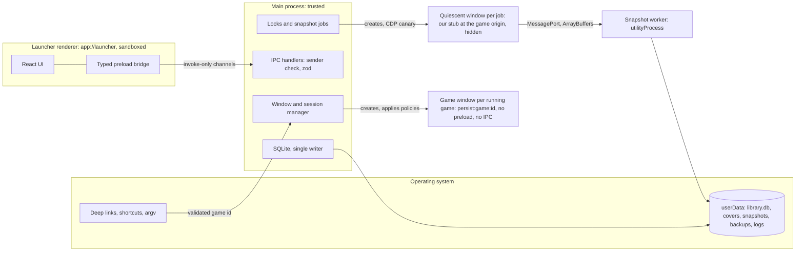
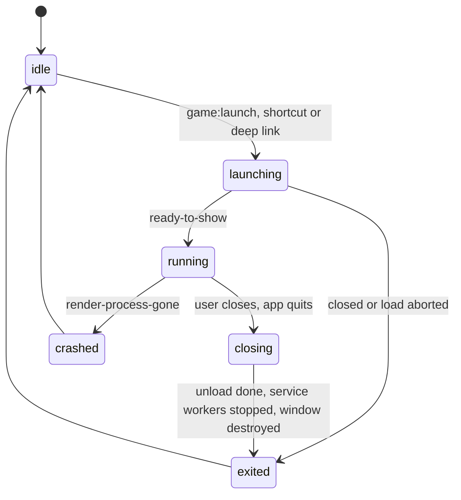

# Architecture of the desktop client

Status: draft for Phase 1, 2026-10-25. Normative for `apps/desktop` and the shared packages. Product requirements are in
the [PRD](../product/prd.md) (features `F-n`, acceptance criteria `AC-n`, open questions `OQ-n`); this spec does not
repeat them, it says how they are built. Runtime: Electron 45 ([ADR-0002](../adr/0002-desktop-runtime.md), desktop
runtime), accepted by the owner with one condition: H7 frame time is re-measured in Phase 1 on the launcher against
Chrome. `Owner` (decision of 2026-10-25). The evidence is the spike,
[RESULTS.md](../../spikes/runtime-compat/RESULTS.md). Related: [snapshot-format.md](snapshot-format.md), [save-transfer.md](save-transfer.md), [security.md](security.md).
Conventions (MUST, claim tags, `Assumed` for calls made here) are those of
[snapshot-format.md](snapshot-format.md#conventions).

## 1. Process model and trust boundaries



| Process | Trust | Owns | Never |
| --- | --- | --- | --- |
| Main | Trusted | Windows, sessions and their policies, IPC, locks, the SQLite database (only writer), the OS integration | Runs code from a game, snapshot or deep link (AGENTS.md security invariant 7) |
| Launcher renderer | Semi-trusted (our code, renders untrusted strings) | React UI on `app://launcher` | Gets Node, file paths or generic IPC |
| Game window | Untrusted | The game page, one window per running game | Gets a preload, IPC, Node or the launcher's session (invariants 1 and 2) |
| Quiescent window | Our code in the game's origin | Export and import for one job | Runs game code (canary, [save-transfer.md](save-transfer.md#5-quiescent-window)) |
| Snapshot worker | Trusted code, untrusted input | Archive validation, encoding, hashing, zstd, files | Writes the database (it reports to main) |

The boundaries and their threats are in [security.md](security.md#2-trust-boundaries). `Owner` for the process split
(plan, design decisions), `Assumed` for the details.

## 2. Module map

| Path | Content | Depends on |
| --- | --- | --- |
| `apps/desktop/main` | App lifecycle, window and session manager, policies (pure, unit-tested functions: URL decisions, permission decision, playtime, badges, window-state guard), IPC handlers, SQLite access and migrations, locks, jobs, deep links, shortcuts, logs; a second build entry for the snapshot worker | `packages/shared`, `packages/snapshot` |
| `apps/desktop/preload` | Two bundles: the launcher bridge and the quiescent preload (built from `packages/exporters`) | `packages/shared`, `packages/exporters` |
| `apps/desktop/renderer` | React UI | `packages/shared` (types only) |
| `packages/shared` | Types, zod schemas, the IPC contract, error codes, id helpers | none |
| `packages/snapshot` | The `.wgsnap` codec (pure TypeScript, Web APIs only), limits, golden vectors | none |
| `packages/exporters` | Generic exporter and importer, inventory, declarative adapters and their schema | `packages/snapshot`, `packages/shared` |

None of these exists yet; each is created with the Phase 1 work that needs it (AGENTS.md, no empty artifacts). Build
and packaging tools are ADR-0004 (toolchain and repository layout). `Assumed`

## 3. On-disk layout

```text
<userData>/
  library.db, library.db-wal, library.db-shm
  covers/<gameId>-<random>.<png|jpg|webp>
  snapshots/<gameId>/<revisionId>.wgsnap      exports and imported files, immutable
  backups/<gameId>/<revisionId>.wgsnap        pre-import and pre-delete backups, never deleted automatically
  backups/library-v<n>-<time>.db              database copy before a schema migration
  tmp/                                        *.partial files; emptied at start-up
  logs/main.log                               redacted, rotated (5 files of 5 MiB)
  Partitions/...                              Chromium's per-partition data
```

- Chromium's partition directories are never read, copied or deleted by our code; storage is reached only through
  browser APIs (AGENTS.md data-safety invariant 1). How Electron names them on disk is Unverified and irrelevant.
- Files are written as `.partial` in `tmp/`, flushed with `fsync`, then renamed into place, so a crash never leaves a
  half-written snapshot or backup under its final name. `Assumed`

## 4. Game session lifecycle



- **One window per game.** A launch while the game is `launching` or `running` focuses that window (shows and restores
  it if minimized) instead of opening another (F-5); a launch while it is `closing` opens and shows nothing and returns
  `{window: "closing"}`, so the caller can say so. A window that has not reached `ready-to-show` after 15 s
  (`LAUNCH_SHOW_TIMEOUT_MS`) is shown anyway and the game is `running`, so a page that never answers is visible in its
  real state and can be closed like any other. `Owner` for the session, `Assumed` for the focus, closing and timeout
  rules.
- **Per-game lock** in the main process: `none`, `session` (any state but `idle`), `task` (export, import, delete local
  saves, clear cache) or `needs_recovery`. A launch is refused with `GAME_BUSY` or `NEEDS_RECOVERY` while a task or a
  recovery holds it; a task is refused with `GAME_RUNNING` while the session holds it (AC-11). `Assumed`
- **Close procedure (MUST, AC-13, spike finding H16).** A closed window's renderer lived 27.8 s, until the game's service
  worker stopped. Verified (2026-10-24, RESULTS.md H16). Electron 45 has no API to stop a service worker: `ServiceWorkers`
  offers `getAllRunning`, `getInfoFromVersionID`, `getWorkerFromVersionID` and `startWorkerForScope`. Verified
  (2026-10-25, `electron.d.ts` in the `electron@45.0.0` package). The experimental CDP domain `ServiceWorker` has
  `stopAllWorkers` and `stopWorker(versionId)`. Verified (2026-10-25,
  <https://raw.githubusercontent.com/ChromeDevTools/devtools-protocol/master/pdl/domains/ServiceWorker.pdl>).
  `BrowserWindow.destroy()` skips `beforeunload` and `unload`. Verified (2026-10-25, same `electron.d.ts`). So, on the
  window's `close` event the main process MUST:
  1. prevent the default close, hide the window and stop playtime;
  2. load `about:blank` in the same `webContents`, so that the game's `beforeunload`, `pagehide` and `unload` handlers
     run and can save (a `will-prevent-unload` asks the user with a native dialog; on "Stay" the window is shown again
     and the game keeps running);
  3. attach `webContents.debugger`, send `ServiceWorker.enable` and `ServiceWorker.stopAllWorkers`, and wait until
     `session.serviceWorkers.getAllRunning()` is empty, at most 2 s; if any remains, send `ServiceWorker.stopWorker` for
     each version id and log `SW_STOP_FAILED` if that does not help;
  4. destroy the window and record `exited`.

  It works through `webContents.debugger` in Electron 45: in the AC-13 e2e test (`apps/desktop/e2e/game-lifecycle.spec.ts`,
  progress-lab on `localhost` with its service worker running) the session had no running worker and the game's
  renderer process was gone 107 to 110 ms after the close (two runs), no process of the game remained 5 s after the close, and 5 s after
  quitting with the game open (the quit took 240 to 258 ms) no process of the bundle remained. With step 3 removed (a mutation
  run of the same test) the worker was still running and the game's renderer still alive 5 s after the close, as in
  H16. Verified (2026-10-28, Electron 45.0.0, macOS arm64, one machine; `pnpm test:e2e:desktop`). App quit runs the
  same procedure for every open game window in parallel, at most 3 s, flushes the log, then quits (`before-quit` in
  `apps/desktop/src/main/index.ts`); the e2e test checks the procedure's records after the quit, and fails with that
  wiring removed (Verified, 2026-10-28, mutation run).
- **Close procedure details** (`apps/desktop/src/main/games/close-procedure.ts`, `Assumed`): step 2 waits at most 2 s
  for `about:blank` (a hanging `unload` cannot block closing); a `will-prevent-unload` is not answered in the event
  (the native dialog is asynchronous): the unload is cancelled, the user is asked, and on "Leave" (or when the dialog
  fails) `about:blank` is loaded again with the trap ignored; each CDP command is tried on its own and given up after
  1 s, so one that fails or hangs never skips the others (each `stopWorker` included); a debugger that cannot attach is
  logged (`game.close.debugger-failed`); whatever failed on the way, workers still running at the end of step 3 are
  logged as `SW_STOP_FAILED`, and the window is destroyed. A window already destroyed is left alone. Chromium runs a
  `beforeunload` prompt only for a page that had a user gesture.
- **Runtime details** (`apps/desktop/src/main/games/lifecycle.ts`, `Assumed`): the `launching` state is claimed before
  the first `await`, so two launches in the same turn open one window (Review Focus 3, e2e); a launch while the game is
  `closing` returns `closing` (the window already shows `about:blank`); a never-answering entry server is shown after
  the launching timeout (e2e, `/never` test page); a load that fails while
  `launching` (a refused cross-site redirect, a network error) destroys the window (`launching → exited`); `exited` and
  `crashed` are reported until the next launch, which treats both as `idle`. A launch also refuses a library entry
  whose stored URL this build does not allow (`URL_NOT_ALLOWED`) and an entry marked `needs_recovery` in the database.
- **Lock details** (`apps/desktop/src/main/games/locks.ts`, `Assumed`): background work never blocks what the user
  does. A launch (`session`) and a user task (`task`: export, import, verify, delete local saves, clear cache) both
  cancel a `background` lease (a storage check) the same way: its signal is aborted with `CANCELLED` and the request
  waits for its release; when it is not released within 2 s the request is refused with `INTERNAL` (logged
  `locks.background-not-released`), because the job may still be touching the game's storage; while the request
  waits the game counts as held by it. A background request never cancels another one (`GAME_BUSY`), and a user task
  still refuses a launch with `GAME_BUSY` (plan M5). Verified (2026-10-28, `locks.test.ts`;
  `apps/desktop/e2e/quiescent.spec.ts`: an export right after a close cancelled the running check and succeeded).
  The process-wide cap of two snapshot jobs (`snapshots/quiescent/slots.ts`) follows the same rule: when both slots
  are taken and one holds a background job (a storage check of any game), a user task cancels that job and takes
  its slot once it is given back, waiting at most 2 s (then `INTERNAL`, logged `snapshot.job.slot-not-released`); a
  user task meets `GAME_BUSY` from the cap only while two user tasks run, and a background job never takes another
  job's slot. Verified (2026-10-28, `job.test.ts`).
- **Crash and hang.** `render-process-gone` ends the session as `crashed` and the library shows it; `unresponsive`
  offers "Force close", which uses `webContents.forcefullyCrashRenderer()`. `Assumed`. The e2e test crashes a game
  with `forcefullyCrashRenderer` and force-closes a really hung page; it emits the window's `unresponsive` event itself,
  because no such event came within 90 s of input to the hung page while Playwright was attached (Verified,
  2026-10-28, same run); that Chromium suppresses it while a debugger is attached is Assumed.

## 5. Game windows and sessions

- **Window factory (AC-3).** A pure function returns the game window's `webPreferences`: `partition:
  "persist:game:<gameId>"`, `sandbox: true`, `contextIsolation: true`, `nodeIntegration: false`,
  `nodeIntegrationInWorker: false`, `nodeIntegrationInSubFrames: false`, `webSecurity: true`,
  `allowRunningInsecureContent: false`, `experimentalFeatures: false`, no `enableBlinkFeatures`, `webviewTag: false`,
  `spellcheck: false`, `safeDialogs: true`, `navigateOnDragDrop: false`, and no `preload`. Its unit test asserts every
  value. `Owner` (AGENTS.md security invariant 1), `Assumed` for the extra hardening keys.
- **Session setup.** One function, `gameSession(gameId)`, is the only way to obtain a game session; on first use it
  installs the permission request and check handlers, the device, HID, serial, USB and Bluetooth refusals, the download
  refusal, and turns the spell checker off. `app.on("session-created")` installs deny-all handlers on every session as a
  baseline, and `app.on("web-contents-created")` refuses `<webview>` attachment and new windows by default. The
  decisions themselves are tables in [security.md](security.md#5-permission-and-navigation-policy) (AC-4, AC-5).
- **Same-site decisions** use one function `siteOf(origin)` (scheme plus registrable domain from the Public Suffix List;
  the host itself for IP addresses and `localhost`). The PSL dependency is `tldts` 7.4.19 (MIT, with `tldts-core`,
  MIT) with `allowPrivateDomains: true`, so `a.github.io` and `b.github.io` are different sites, as Chromium's
  schemeful site is assumed to treat them. Where no registrable domain exists (a bare public suffix such as `co.uk`, a
  single-label host, a host with a trailing dot or an empty label such as `example..com`) the whole host is the site, so different hosts never share one; ports
  never matter. Implemented in `apps/desktop/src/main/policy/site.ts`. `Assumed`
- **Storage partitioning stays on.** Playwright's Electron loader appends `ThirdPartyStoragePartitioning` to
  `--disable-features`, which makes a cross-site iframe share storage with the top level; re-appending the list without
  that entry in the main process restores partitioning. Verified (2026-10-24, RESULTS.md H11). The app MUST do this at
  start-up whenever the switch contains that entry, in every build, because partitioning is what the storage keys of
  snapshots assume. `Assumed` for the rule. Implemented as `fixPartitioningSwitch` in `apps/desktop/src/main/start-up.ts`;
  the e2e test "cross-site iframe storage stays partitioned under Playwright" (`apps/desktop/e2e/launcher.spec.ts`)
  shows a cross-site progress-lab iframe in its own empty partition under `_electron.launch`, and with the fix removed
  the same test fails because the iframe sees the top-level progress. Verified (2026-10-28, Electron 45.0.0,
  Playwright 1.64.1, macOS arm64). Playwright adds that loader only when `_electron.launch` gets no `executablePath`.
  Verified (2026-10-28, `coreBundle.js` of `playwright-core` 1.64.1).
- **Frames are recorded.** `did-frame-navigate` with an http or https URL adds `(top origin, frame origin)` to
  `storage_targets` ([save-transfer.md](save-transfer.md#2-storage-keys)), once per key and window
  (`apps/desktop/src/main/games/frames.ts`).
- **Implementation (Phase 1 Task 8).** `apps/desktop/src/main/games/`: `window-factory.ts` (`gameWebPreferences`,
  unit-tested value by value with `toStrictEqual`, S-1; the navigation and window-open wiring; the "Open in browser?"
  opener), `game-session.ts` (`gameSession`, `installBaselineHandlers`), `lifecycle.ts`, `locks.ts`,
  `close-procedure.ts`, `frames.ts`. Main-frame navigations are decided on `will-navigate` and `will-redirect`,
  subframes on `will-frame-navigate` and subframe redirects; log lines name only the origin (or the scheme) of a URL a
  game chose. `Assumed`

## 6. IPC contract

Launcher renderer to main, invoke-only (`ipcRenderer.invoke` / `ipcMain.handle`). No generic `send` or `invoke` is
exposed: the preload offers one typed function per channel and two event subscriptions. Electron 45 sandboxed preloads
no longer have `Buffer`, `events`, `timers` or `url`, so the bridge uses none of them. Verified (2026-10-24,
<https://releases.electronjs.org/release/v45.0.0>).

| Channel | Request | Response `data` |
| --- | --- | --- |
| `library:list` | `{}` | `{library: "ready", cards, canCreateShortcuts}` (card: id, title, url, cover URL, badges, last launch, playtime, session state, needs recovery) or `{library: "read-only", reason}` (section 7) |
| `library:add` | `{url, title?}` | The new card (rules in section 12) |
| `library:update` | `{gameId, title?, cover?: "pick" \| "remove"}` | The card; `pick` opens the file dialog in main |
| `library:remove` | `{gameId}` | `{}` (section 12) |
| `library:orphans`, `library:deleteOrphanData` | `{}`, `{gameId}` | Orphan list; `{taskId}` |
| `game:launch`, `game:focus` | `{gameId}` | `{window: "opened" \| "focused" \| "closing", state}`, `{}` |
| `game:clearCache`, `game:deleteSaves` | `{gameId}` | `{}`, `{taskId}` |
| `snapshot:export` | `{gameId, frameKeys?}` | `{taskId}` |
| `snapshot:import` | `{gameId, source: {revisionId} \| "file", mapping?: [{from, to}]}` | `{taskId}`; `"file"` opens the file dialog in main |
| `snapshot:list` | `{gameId}` | Snapshot rows (section 7) |
| `snapshot:verify` | `{gameId, revisionId}` | `{taskId}` |
| `snapshot:saveAs` | `{gameId, revisionId}` | `{saved}`; save dialog in main |
| `shortcut:create` | `{gameId}` | `{created}`; save dialog in main |
| `settings:get`, `settings:set` | `{}`, a partial object of allowlisted keys | Settings |

Main to the launcher renderer only: `game:state {gameId, state, at}` and `task:progress {taskId, gameId, kind, step,
status: "running" | "done" | "failed", bytesDone?, bytesTotal?, code?}`. Progress reports real steps and measured bytes
only; a percentage appears only when `bytesTotal` is known (AGENTS.md honesty rule 1).

- **Sender check, every handler:** `event.sender` is the launcher window's `webContents`, `event.senderFrame` is its main
  frame, and the frame URL's origin is `app://launcher`. A failing call is rejected without detail and logged once as
  `IPC_FORBIDDEN_SENDER`. `Owner` (AGENTS.md security invariant 6), `Assumed` for the exact test.
- **Validation:** every payload passes a strict zod schema (`packages/shared`); unknown keys are rejected; serialized
  payloads above 64 KiB are rejected. Ids must be lowercase UUIDv7.
- **Errors:** `{ok: false, code, message}`; success is `{ok: true, data}`. `message` is short English for the UI with no
  paths, query strings or save data. Codes: `INVALID_ARGUMENT`, `NOT_FOUND`, `URL_NOT_ALLOWED`, `GAME_RUNNING`,
  `GAME_BUSY`, `NEEDS_RECOVERY`, `CANCELLED`, `LIBRARY_READ_ONLY`, `INTERNAL`, and the `SNAP_*`, `EXP_*` and `IMP_*`
  codes of the other specs. `LIBRARY_READ_ONLY` is what every channel except `library:list` and `settings:get`
  returns while the database is read-only, reads such as `library:orphans` and `game:focus` included (section 7).
  `Assumed`
- **No paths cross IPC.** The renderer never sends a file path or an arbitrary URL to open; files are chosen in native
  dialogs owned by main, and destructive actions (remove, delete local saves, import, a storage-key mapping) are confirmed
  in a native dialog whose text main writes. `Assumed`
- **Implementation (Phase 1 Task 9).** `Assumed` unless noted.
  - The schemas are `packages/shared/src/ipc.ts` (`IPC_CONTRACT`; every request and response object is a
    `z.strictObject`, which a unit test checks by walking the schemas); the bridge's shape is
    `packages/shared/src/bridge.ts` (`window.wg`: one function per channel, `onGameState`, `onTaskProgress`,
    `bridgeVersion` 4 since Task 13 added the snapshot functions and `onTaskProgress`), which the preload imports
    without zod.
  - Main: `apps/desktop/src/main/ipc/` (`sender-check.ts`, `register.ts`, `handlers/`). The sender check compares
    `event.sender` with the launcher's `webContents` by identity, the sender frame with its main frame by process and
    routing id (the `WebFrameMain` wrapper object is not compared), requires `parent === null`, and compares the
    frame URL's scheme and host with `app://launcher` (WHATWG gives non-special schemes an opaque origin, so the
    origin is built from scheme and host); the dev flavor compares with `DEV_LAUNCHER_ORIGIN`,
    `http://localhost:5173` (`app-protocol.ts`, the `DEV_SERVER` of `electron.vite.config.ts`).
  - A refused sender gets `{ok: false, code: "INVALID_ARGUMENT", message: "Refused."}`, the same for every check, and
    each refused call writes one `IPC_FORBIDDEN_SENDER` record (channel, the frame URL through `redact`, whether it was
    a subframe). A call must carry exactly one payload of plain data: strings, numbers, booleans, null, undefined
    and objects whose prototype is `Object.prototype` or null, at most 8 levels deep and 4 096 values in all (structured
    clone keeps shared references, so a small graph of shared objects could otherwise take about k^7 visits); a value
    that throws while it is walked is refused too. Electron IPC uses structured
    clone, so a `Map`, `Set`, `ArrayBuffer`, typed array, `Date` or class instance arrives intact, and
    `JSON.stringify` measures most of them as `{}` while `z.strictObject({})` accepts them; they are refused. An
    array is accepted only inside the request object, with at most 32 items (`MAX_PAYLOAD_ARRAY_LENGTH`, the
    `maxStorageKeys` bound of `snapshot:export`'s `frameKeys`), dense, with no own property but its indexes and
    `length`, and its items count against the 4 096-value budget; the length is checked before anything walks it,
    because a sparse array of length 2^32 − 1 kept `JSON.stringify` busy for about 54 s in a unit test (Verified
    2026-10-28, `register.test.ts` before the fix). The array rule is unit-tested at the limit, above it, sparse,
    with an extra property and as a subclass (Verified 2026-10-28, `register.test.ts`). Only then is the `JSON.stringify` form
    measured in UTF-8 bytes: above 65 536 bytes, or without a JSON form (BigInt), it is `INVALID_ARGUMENT` before zod
    runs. zod issues are
    logged as codes and paths only, never returned. A throwing handler is `INTERNAL` ("Something went wrong.").
  - `settings:get` and `settings:set` exist with an empty allowlist (`settingsSchema` is `z.strictObject({})`): no
    setting exists yet, so every key is refused and nothing is stored.
  - `game:state` is sent on every state change of the game runtime (`GameRuntime`'s `onState`), once per change,
    with `at` in Unix milliseconds; a refused launch reports `idle` again.
- **Implementation (Phase 1 Task 13).** `Assumed` unless noted.
  - `snapshot:export {gameId, frameKeys?}`, `snapshot:list {gameId}` and `snapshot:saveAs {gameId, revisionId}`
    exist (`apps/desktop/src/main/ipc/handlers/snapshots.ts`). An export answers `{taskId}` once the game's lock is
    held; a refusal before that (`GAME_RUNNING` while the window is open, AC-11, `GAME_BUSY` also when two user tasks
    run already, `NEEDS_RECOVERY`, `NOT_FOUND`, `INVALID_ARGUMENT` for a frame that is not the game's,
    `SNAP_MANIFEST_INVALID` for a game with more than 32 storage keys) is the call's own result. Verified (2026-10-28,
    `apps/desktop/e2e/export.spec.ts` through `window.wg`).
  - No `task:progress` event of an export reaches the page before the reply with its `{taskId}`: the handler holds
    them until the turn after it answered (`handlers.test.ts`).
  - `task:progress` events carry `kind` `export`, `step` `lock`, `read` (with `bytesDone`, the entry bytes the
    snapshot worker received, measured) or `write`, and `status`; a failure adds its `code` and a short `message`
    (no path or value), so the UI can show the real error (Review Focus 5). `bytesTotal` is never sent for an export:
    nothing knows the total before the read ends. Verified (2026-10-28, same spec: lock, read with bytes, write, done,
    no `bytesTotal`).
  - `snapshot:list` returns the rows of the game and of its base revision (plan M8) without their file paths;
    `snapshot:saveAs` copies the stored file to the place chosen in the native save dialog (`saved: false` on Cancel).
  - A result's `code` may be any code of the specs (`IpcResult` uses `ErrorCode`), as the error list above says.
- Game windows have no IPC at all; quiescent windows use only the handshake of
  [save-transfer.md](save-transfer.md#5-quiescent-window). Bulk data never travels as JSON IPC (AGENTS.md data-safety
  invariant 9).

## 7. SQLite schema v1

`node:sqlite` in the main process, the only writer (AGENTS.md data-safety invariant 9); the library survives restarts in
this file (AC-1). It worked in the Electron 45 main process and in a `utilityProcess` with WAL, `PRAGMA user_version`,
close and reopen, and no warning. Verified (2026-10-24, RESULTS.md H10). Its API is synchronous (`DatabaseSync`), and `PRAGMA user_version` set inside a rolled-back
transaction is rolled back too. Verified (2026-10-25, Node 24.13.0, run locally).

```sql
-- per connection: PRAGMA journal_mode = WAL; PRAGMA foreign_keys = ON; PRAGMA synchronous = FULL;
CREATE TABLE device (id TEXT PRIMARY KEY, created_at INTEGER NOT NULL);           -- one row, random UUIDv7
CREATE TABLE games (
  id TEXT PRIMARY KEY,                -- UUIDv7, independent of the URL
  url TEXT NOT NULL, title TEXT NOT NULL, cover_path TEXT,
  support_mode TEXT NOT NULL DEFAULT 'by-link' CHECK (support_mode = 'by-link'),
  base_revision_id TEXT,              -- revision the partition's data descends from (rule in save-transfer.md)
  needs_recovery INTEGER NOT NULL DEFAULT 0,
  last_launched_at INTEGER, created_at INTEGER NOT NULL, updated_at INTEGER NOT NULL);
CREATE TABLE window_state (
  game_id TEXT PRIMARY KEY REFERENCES games(id) ON DELETE CASCADE,
  x INTEGER, y INTEGER, width INTEGER NOT NULL, height INTEGER NOT NULL, display_id TEXT,
  maximized INTEGER NOT NULL, fullscreen INTEGER NOT NULL, updated_at INTEGER NOT NULL);
CREATE TABLE play_sessions (
  id INTEGER PRIMARY KEY, game_id TEXT NOT NULL REFERENCES games(id) ON DELETE CASCADE,
  started_at INTEGER NOT NULL, ended_at INTEGER, active_ms INTEGER NOT NULL DEFAULT 0, checkpoint_at INTEGER NOT NULL);
CREATE TABLE storage_targets (        -- no foreign key: kept for orphaned data
  game_id TEXT NOT NULL, top_origin TEXT NOT NULL, frame_origin TEXT NOT NULL,
  in_export INTEGER NOT NULL DEFAULT 0, first_seen_at INTEGER NOT NULL, last_seen_at INTEGER NOT NULL,
  PRIMARY KEY (game_id, top_origin, frame_origin));
CREATE TABLE snapshots (              -- no foreign key: snapshots outlive the card
  revision_id TEXT PRIMARY KEY, game_id TEXT NOT NULL,
  kind TEXT NOT NULL CHECK (kind IN ('export', 'backup', 'imported')),
  manifest_game_id TEXT NOT NULL, parent_revision_id TEXT, created_at TEXT NOT NULL, device_id TEXT NOT NULL,
  exporter_id TEXT NOT NULL, exporter_version TEXT NOT NULL, adapter_id TEXT, adapter_version TEXT,
  content_hash TEXT NOT NULL, size_bytes INTEGER NOT NULL, path TEXT NOT NULL,
  flush_state TEXT NOT NULL CHECK (flush_state IN ('confirmed', 'unconfirmed')),
  verified_at INTEGER, verified_exporter_version TEXT, added_at INTEGER NOT NULL);
CREATE TABLE restore_journal (
  id TEXT PRIMARY KEY, game_id TEXT NOT NULL, kind TEXT NOT NULL CHECK (kind IN ('import', 'delete-saves')),
  revision_id TEXT, backup_revision_id TEXT, step TEXT NOT NULL,
  state TEXT NOT NULL CHECK (state IN ('running', 'rolling-back', 'done', 'failed')),
  started_at INTEGER NOT NULL, updated_at INTEGER NOT NULL);
CREATE TABLE storage_checks (game_id TEXT PRIMARY KEY, checked_at INTEGER NOT NULL, has_data INTEGER NOT NULL);
CREATE TABLE orphans (game_id TEXT PRIMARY KEY, url TEXT NOT NULL, title TEXT NOT NULL, removed_at INTEGER NOT NULL);
CREATE TABLE settings (key TEXT PRIMARY KEY, value TEXT NOT NULL);                -- JSON, allowlisted keys
CREATE INDEX snapshots_by_game ON snapshots (game_id, added_at);
CREATE INDEX play_sessions_by_game ON play_sessions (game_id, started_at);
```

- Times are Unix milliseconds UTC, except `snapshots.created_at`, the manifest's display string. `Assumed`
- **Migrations:** numbered, append-only SQL files; `PRAGMA user_version` is the schema version. Each migration runs in
  one transaction that also sets `user_version`. Before migrating an existing database the main process copies it to
  `backups/library-v<n>-<time>.db`. A database whose `user_version` is newer than the app knows is opened read-only and
  the app shows an explicit error instead of writing. `Assumed`
  - *What the user sees (Phase 1 Task 9).* With a read-only database the game runtime is not created,
    `library:list` returns `{library: "read-only", reason}` and the UI shows the reason in place of the library (and
    an alert in Settings); every other channel except `settings:get` returns `LIBRARY_READ_ONLY` (section 6), so
    nothing is read through the repositories or written. A database that cannot be opened at all (a corrupt file, a
    failed migration, which is rolled back) stops start-up with a native error dialog, "WGLauncher cannot open its
    library", logged as `db.open-failed`, then exit code 1; the file is not changed. Verified (2026-10-28,
    `apps/desktop/e2e/library.spec.ts` on Electron 45.0.0, macOS arm64, test flavor, where the dialog is recorded
    instead of shown). `Assumed` for the rest.
  - *How it is built (Phase 1 Task 6, `apps/desktop/src/main/db/`).* The SQL files are imported as strings with Vite's
    `?raw` suffix, so electron-vite inlines them into the main bundle and Vitest reads them the same way; no file is
    looked up at run time. `Assumed`. The copy before a migration is made with `VACUUM INTO` (a consistent copy of what
    the connection sees, WAL content included, so no checkpoint or file copy of a live database is needed), written
    as `.partial` in `tmp/` (section 3), flushed and renamed into `backups/` (same volume, `Assumed`), removed on a failure, and
    never over an existing backup; its `<n>` is the `user_version` it holds.
    A fresh database makes no copy. A database with a newer `user_version` is first opened with `readOnly: true`, so
    even reading its version writes nothing to the main file. Verified (2026-10-28, Node 24.13.0, run locally:
    `VACUUM INTO` kept `user_version` and wrote a rollback-journal copy; a read-only open of a WAL database created
    empty `-wal` and `-shm` files and left the main file's bytes unchanged).
  - A test compares `001-initial.sql` with the SQL block above, so the two cannot drift apart. `Assumed`
- Statements are synchronous, so each must be small and indexed (section 13). The worker never opens the database.

## 8. Shortcuts and deep links

- **Forms.** Deep link `wglauncher://launch/<gameId>`; launch argument `--launch-game=<gameId>`. Both open the game from
  its shortcut (AC-1); no per-game bundle exists (F-8, anti-goal 7). `Owner`
- **Single instance.** `app.requestSingleInstanceLock()`; if it fails the process quits at once. A running instance
  receives arguments through `second-instance` and, on macOS, URLs through `open-url`, registered before `ready` and
  queued until the window manager is up. The packaged, ad-hoc-signed spike app kept one main process and received the id
  through `open-url` (not running and running) and `second-instance`. Verified (2026-10-24, RESULTS.md H15).
- **Untrusted input (AC-19).** The whole URL must match
  `^wglauncher://launch/[0-9a-f]{8}-[0-9a-f]{4}-7[0-9a-f]{3}-[89ab][0-9a-f]{3}-[0-9a-f]{12}$` (and the argument the same
  id pattern); no query, fragment, user info or port. A malformed value shows the library with an error and navigates
  nowhere; a well-formed but unknown id shows the library with "not in the library". Never more than one game window per
  id. `Assumed`
- **Windows shortcut:** `shell.writeShortcutLink(path, "create", {target: process.execPath, args:
  "--launch-game=<id>", description, icon: process.execPath, iconIndex: 0})`, the path from a save dialog (default:
  Desktop). The API and these options exist. Verified (2026-10-25, `electron.d.ts` in `electron@45.0.0`). The installed
  app registers the scheme with `app.setAsDefaultProtocolClient("wglauncher")`; on Windows a deep link arrives as a
  command-line argument, so the parser accepts exactly one argument that is either a whole deep link or
  `--launch-game=<id>` and ignores the rest. Behavior on Windows is Unverified (no machine). `Assumed`
- **Parser details** (`apps/desktop/src/main/policy/deep-link.ts`, `Assumed`): a command-line argument is a launch
  argument when it starts with `--launch-game` or `wglauncher:`, compared case-insensitively; every other argument
  (executable, app path, Electron and Chromium switches, `--`) is ignored. No launch argument means no launch; two or
  more, even identical ones, are invalid, because an extra one may have been injected. A launch argument is never
  split, so one with spaces or `--` inside is a single value that fails the id pattern. Upper-case ids and an
  upper-case scheme are invalid. Results carry only the input's length, never its text. If Windows turns out to
  append a trailing slash to a deep link, the link is refused until that is verified and the rule amended; whether it
  does is Unverified (no Windows machine).
- **macOS:** the scheme is declared in `Info.plist` (`CFBundleURLTypes`), because `setAsDefaultProtocolClient` works on
  macOS only for schemes declared at build time. Verified (2026-10-24, <https://www.electronjs.org/docs/latest/api/app>).
  The shortcut is a `.webloc` file whose only variable part is the validated id. A `.command` file is not offered,
  because it runs a shell script. Development builds do not register the scheme: `setAsDefaultProtocolClient` leaves a
  LaunchServices preference that outlives the app. Verified (2026-10-24, RESULTS.md H15). `Assumed` for the choices.
- **Implementation (Phase 1 Task 11).** `Assumed` unless noted.
  - `apps/desktop/src/main/launch-input.ts`: `index.ts` registers `second-instance` and `open-url` (with
    `preventDefault`) right after the single-instance lock is granted, before `ready`, and pushes each request, and
    the first start's own `process.argv`, into a queue (`createLaunchQueue`) that is started once the game runtime
    exists and the launcher page has loaded; requests are then handled one at a time in arrival order, so a very
    early second start is neither lost nor exits without being handled. A request is logged as `launch.input` with
    its source and `result: "valid"` with the id, `"invalid"` with the length, or `"none"` (security.md section 9).
  - A valid, known id goes to `GameRuntime.launch`, which opens the game or focuses its one window. A malformed value,
    an unknown id, a refused launch (`GAME_BUSY`, `NEEDS_RECOVERY`, `URL_NOT_ALLOWED`), a game that is still closing
    and a read-only library each bring the launcher to the front (shown, restored, focused) and show a native notice
    with one OK button (`Dialogs.notify`, an asynchronous message box, so the main process is not blocked as
    `showErrorBox` would block it): "The launch link is not valid", "The game is not in the library", "The game
    cannot be opened" or "The game is closing". The renderer gets no new event; nothing navigates. A second start
    without a launch argument only brings the launcher to the front, as before.
  - *Follow-up fix (2026-10-28).* The launch queue does not wait for a notice: notices go through their own chain
    (`createNoticeChain`), one at a time in order, so a valid shortcut clicked while a notice is open is handled at
    once. At most `MAX_QUEUED_LAUNCH_REQUESTS` (16) requests wait and at most `MAX_PENDING_NOTICES` (4) notices; more
    are dropped and logged (`launch.dropped` with the source, `launch.notice-dropped` with the title). "Show the
    library" opens the launcher window again when the user closed it while a game ran (`launcher.reopened`), and on
    macOS a Dock click (`activate`) with no launcher window does the same; a dialog whose parent window was destroyed
    appears unparented (`liveParent`). `library:list` carries `canCreateShortcuts` (`shortcutsSupported`: macOS and
    Windows), and the card shows "Create shortcut" only where it can work. e2e: with the launcher closed and a game
    running, a second instance with an unknown id opened the launcher again and showed "The game is not in the
    library". Verified (2026-10-28, `apps/desktop/e2e/shortcut.spec.ts`, Electron 45.0.0, macOS arm64). The Dock click
    is part of the Task 16 manual checks.
  - `shortcut:create {gameId}` (`apps/desktop/src/main/shortcuts.ts`): a native save dialog in main, defaulting to
    `app.getPath("desktop")` and a file name made from the title (separators, reserved and control characters become
    `-`, format characters such as U+202E are removed, no leading dot, at most 100 characters, "WGLauncher game" when
    nothing is left or the name is a Windows device name such as `CON`, `nul.txt` or `COM1`); the extension is added
    when the chosen name lacks it. On macOS it writes the `.webloc` plist whose only content is
    `<string>wglauncher://launch/<id></string>` (XML-escaped; the id is checked to be a lowercase UUIDv7 first). On
    Windows it calls `shell.writeShortcutLink(path, "create", {target: process.execPath, args:
    "--launch-game=<id>", description: "<title> (WGLauncher)", icon: process.execPath, iconIndex: 0})`; unit-tested
    arguments only, not tested on Windows. Other systems get "Shortcuts can be created on macOS and Windows only."
    (`INTERNAL`); Linux is not a target yet (PRD section 11). In dev and test builds a `.webloc` points at a scheme no
    build of theirs registers. Cancel is `CANCELLED`; a failed write is `INTERNAL` with no path in the message.
  - `registerDeepLinkScheme` calls `app.setAsDefaultProtocolClient("wglauncher")` in the packaged prod build only
    (`app.isPackaged`); dev and test builds never call it (unit test).
  - e2e (`apps/desktop/e2e/shortcut.spec.ts`, plan M13): the first start with `--launch-game=<id>` opened that game;
    a second instance with the same argument exited 0 and the minimized game window was restored and shown, still one
    game window; second instances with a hostile value, an upper-case deep link, two arguments and an unknown id each
    exited 0, showed the notice, opened no window and left the launcher page's URL unchanged, and the log held none
    of the input text; "Create shortcut" wrote exactly the `.webloc` above and nothing else. Verified (2026-10-28, Electron 45.0.0,
    macOS arm64, test flavor). The `wglauncher://` scheme and opening a `.webloc` are checked by hand on the packaged
    app (Task 16).

## 9. Window state and fullscreen

- On `close` and, debounced by 500 ms, on `move` and `resize`, the window's `getNormalBounds()`, `isMaximized()`,
  `isFullScreen()` and the id of `screen.getDisplayMatching(bounds)` go to `window_state` (F-7). `Assumed`
- **Off-screen guard:** saved bounds are used only if they overlap the work area of a connected display by at least
  100 by 50 pixels; otherwise the window opens at the default size (1280 by 800) centered on the primary display. Then
  maximized and fullscreen are re-applied. `Assumed`
- The guard (`restoreBounds`, `apps/desktop/src/main/policy/window-guard.ts`) checks the overlap against each display's
  work area on its own, so the saved display id is only a hint and an overlap with another display is accepted. A
  saved record with a size but no x or y (or one that is not a finite number) keeps its saved size, clamped to the
  primary display's work area, and is centered there (F-7 remembers the size too, and
  `window_state.width` and `height` are `NOT NULL` while `x` and `y` are nullable); a size that is not a positive
  finite number makes the record unusable and gets the default; the default is clamped to a work area smaller than
  1280 by 800. The maximized and fullscreen flags are re-applied by the caller whether or not the saved bounds were
  used. `Assumed`
- **Fullscreen toggle:** the window menu item with role `togglefullscreen` (macOS Ctrl+Cmd+F, Windows F11) and a UI
  control (F-6). `Assumed`
- **Esc stays with the game.** The launcher never consumes Esc: no accelerator on it and no `preventDefault` on it in
  `before-input-event`. A fullscreen that the page requested ends as Chromium handles Esc; Electron 45's behavior there
  is Unverified. A fullscreen that the launcher set ends with the toggle, the UI, or Esc held for 1.5 s (a short press
  only reaches the game). That is how AC-18 "exits on Esc" is met without taking Esc from games. `Assumed`
- **Tests (AC-18, spike finding H13).** H13 was INVALID: `navigator.keyboard.lock()` succeeds without a gesture, and
  `requestPointerLock()` right after `requestFullscreen()` in one handler failed for lack of a gesture while each call
  alone after injected input succeeded. Verified (2026-10-24, RESULTS.md H13). So the Phase 1 e2e test requests pointer
  lock first or gives each call its own injected click, does not expect keyboard lock to need a gesture, and checks
  focus first (pointer lock fails without it). A manual run with real input on macOS completes AC-18.
- **Implementation (Phase 1 Task 10).** `Assumed` unless noted.
  - `apps/desktop/src/main/games/window-state.ts`: the state is saved on the first `close` (before the close procedure
    hides the window; nothing more is saved until a "Stay" shows the window again) and 500 ms after the last `move`,
    `resize`, `maximize`, `unmaximize`, `enter-full-screen` or `leave-full-screen`; nothing after `closed`; a failed
    write is logged (`game.window-state-save-failed`), never thrown. The display id is
    `String(screen.getDisplayMatching(normalBounds).id)`. A fullscreen the page requested itself (from
    `enter-html-full-screen` until `leave-html-full-screen`) is saved as `fullscreen = 0`, because `isFullScreen()` is
    true then too: otherwise the next launch would put the window into a fullscreen the page did not ask for and
    whose exit it cannot drive. A page fullscreen entered over a fullscreen the launcher set is saved as
    not fullscreen as well (Assumed: rare, and the safe side). e2e: a game closed in its own fullscreen was saved
    with `fullscreen` false (Verified, 2026-10-28, `apps/desktop/e2e/window.spec.ts`). A game window is created at `restoreBounds` of its row, and
    the saved maximized and fullscreen flags are applied on its first `show` (it is created hidden).
  - macOS can refuse that fullscreen request without an event: right after a fullscreen window closed, while its
    Space still animated away, `isFullScreen()` turned true and then false again with a `resize`, and neither
    `enter-full-screen` nor `leave-full-screen` came (Verified, 2026-10-28, Electron 45.0.0, macOS arm64: the
    intermittent AC-18 failure in `apps/desktop/e2e/window.spec.ts`, and a probe app; MEMORY.md). So `applySavedFlags`
    treats a `resize` that finds the window not fullscreen before `enter-full-screen` as a refusal and asks again after
    250 ms, at most 8 requests in all, then logs `game.fullscreen-restore-failed` and leaves the window as it is; a
    restore that needed more than one request logs `game.fullscreen-restore-retried`. The restore ends at
    `enter-full-screen`, `leave-full-screen`, the first `close` (the close procedure hides the window and destroys it
    only later) or `closed`; `hide` is no signal, because macOS emits it while a window moves into or out of a
    fullscreen Space (Verified, 2026-10-28, `apps/desktop/e2e/window.spec.ts` instrumented runs). A window already fullscreen when a retry is due is left
    alone. The delay and the limit are `Assumed`; every refused restore observed entered on the second request.
  - The UI control of F-6 is the menu item itself: `apps/desktop/src/main/app-menu.ts` sets an application menu of
    Electron's standard roles with a View menu holding `togglefullscreen` (clickable, and its accelerator is the
    keyboard toggle), the edit roles (copy and paste in the launcher's fields), no accelerator on Esc, and reload and
    developer tools in the dev flavor only. The launcher has no fullscreen button for a game: section 6 has no channel
    for it, and the game window has no UI of its own. `Assumed` (an open point for review).
  - `apps/desktop/src/main/games/fullscreen.ts`: `before-input-event` is only observed; Esc held for 1.5 s (auto-repeat
    does not restart the hold, a key-up, blur or close cancels it, one exit per press) calls `setFullScreen(false)` when
    the window is fullscreen and the page has not requested fullscreen itself (`enter-html-full-screen` until
    `leave-html-full-screen`), logged as `game.fullscreen-esc-exit`.
  - e2e (`apps/desktop/e2e/window.spec.ts`): bounds set on a game window were saved within the debounce and restored
    on the next launch; a fullscreen set from main was saved with the normal bounds and restored; a short Esc sent
    through `webContents.sendInputEvent` (which reaches `before-input-event`) arrived at the page as `keydown` and
    `keyup` with `defaultPrevented` false and the window stayed fullscreen for 2 s; Esc held 1.7 s reached the page
    too and ended the fullscreen. A fullscreen the page requested ended on Esc, and Chromium did not deliver that Esc
    to the page (no `keydown`), as browsers do; this settles plan open check 9. Verified (2026-10-28, Electron 45.0.0,
    macOS arm64, test flavor). An Esc sent at once after `isFullScreen()` turned true, while macOS still animated into
    fullscreen, had no effect in one run (Unverified as a rule). Clicking the menu item and real key presses are the
    manual part (Task 16).

## 10. Playtime

- Rule exactly as [PRD section 8](../product/prd.md#8-playtime-rule): accrues while the game window is visible and
  focused; stops on blur, minimize, system suspend and screen lock; a session under 10 s is dropped. `Owner` for an
  explicit rule, `Assumed` for its numbers (PRD).
- A pure state machine takes events (window `show`, `hide`, `focus`, `blur`, `minimize`, `restore`, `closed`;
  `powerMonitor` `suspend`, `resume`, `lock-screen`, `unlock-screen`) and a monotonic clock, and accrues only while
  visible, focused, not minimized, not suspended and not locked. `lock-screen` exists on macOS and Windows only.
  Verified (2026-10-25, `electron.d.ts` in `electron@45.0.0`). AC-15 tests it with a fake clock.
- A session is one window lifetime. Active time is checkpointed every 60 s; at close a session with less than 10 000 ms
  of active time is deleted, as is an unfinished one found at start-up below that. "Under 10 s" is read as active time.
  `last_launched_at` is set at every launch. `Assumed`
- The machine (`createPlaytime`, `apps/desktop/src/main/policy/playtime.ts`) starts with the window neither visible nor
  focused, so a window that is already up must be replayed to it as `show` and `focus`. Every event is idempotent,
  events after `closed` are ignored, and a clock that steps backwards counts as zero elapsed time (the machine then
  continues from the new reading; time not yet banked by an earlier event is lost). `Assumed`
- **Implementation (Phase 1 Task 10, `apps/desktop/src/main/games/playtime-recorder.ts`).** `Assumed` unless noted.
  When a game window is created its row's `last_launched_at` is set (the database clock) and a `play_sessions` row
  is started; the window's state is replayed (`show`, `focus`, `minimize` when already true, and `suspend` or
  `lock-screen` when the system is suspended or `powerMonitor.getSystemIdleState(1)` says `locked`, asked at every
  launch because Linux emits no lock events); `powerMonitor` `suspend`, `resume`, `lock-screen` and `unlock-screen`
  go to every open session. The clock is `performance.now()`. Step 1 of the close procedure feeds `hide`, so the
  procedure's time and its dialog are not counted and a "Stay" (`show`) counts again. At `closed` the session is ended
  with its active time, or deleted under 10 000 ms. At start-up, before any launch, unfinished sessions under
  10 000 ms are deleted and the others get `ended_at = checkpoint_at`. A failed write is logged
  (`game.playtime-write-failed`). The card shows the sum of `active_ms` as "Playtime" ("less than a minute" under
  60 s) and "Last launched", only when recorded. e2e: a launch closed at once set `last_launched_at` and left no
  session; seeded rows changed the card's playtime and "Local data" badge and nothing else did; after a restart an
  unfinished 5 s session was gone and a 20 s one ended. Verified (2026-10-28, `apps/desktop/e2e/window.spec.ts`,
  Electron 45.0.0, macOS arm64).

## 11. Badges

Badges come from recorded state only ([PRD section 7](../product/prd.md#7-honest-badges)). One pure function
`badgesFor(record)` decides them; AC-14 tests each badge against each state.

| Badge | Shown if and only if |
| --- | --- |
| By link | `support_mode = 'by-link'` (every MVP entry) |
| Needs internet | Same condition as "By link" in the MVP |
| Local data | The latest `storage_checks` row has `has_data = 1`; its `checked_at` is shown with it |
| Export verified | A snapshot of the game has `verified_at` set and `verified_exporter_version` equal to the running exporter's version |
| Compatibility not verified | Always in the MVP: no verification records exist, and the UI never calls a game, runtime or OS verified unless a record in `docs/compat/` backs it (AC-21) |

- A storage check is the quiescent inventory (counts and usage numbers only) over the game's known keys; it runs after
  a game window exits, after an import or a delete, and never while any game window is focused. In Phase 1 Task 13
  (`apps/desktop/src/main/snapshots/{storage-check,check-scheduler}.ts`) it starts 2 s after a game window exits
  (`QUIET_MS`, Assumed: a user who opens the game again at once finds no check to cancel), waits while any game
  window is focused (it runs when the focus changes), runs one check at a time and each game once, holds a
  `background` lease that a launch or a user task cancels (a user task of another game also cancels it for its job
  slot), and is dropped when it cannot start (the next exit schedules it again). A running check is cancelled when
  any game window takes focus (that game is checked again once no game window is focused) and when the app starts
  quitting (`before-quit`), logged `snapshot.storage-check.cancelled`; it only reads, so cancelling it is safe
  (Verified, 2026-10-28, `check-scheduler.test.ts`). After an import or a delete it comes with Task 14. Verified (2026-10-28,
  `check-scheduler.test.ts` and `apps/desktop/e2e/quiescent.spec.ts`: a check after an exit, none for 3.5 s while
  another game window was focused, both games checked once it closed). `has_data` means at
  least one localStorage item or IndexedDB database, or `usageDetails.fileSystem` above zero (OPFS is data too, though
  not exported); this is how "storage usage above zero" is measured. Where `usageDetails` is unavailable, OPFS-only data
  is missed and the badge can be absent although data exists. `Assumed`
- No install, sync, FPS, download, completion or achievement indicator exists (AGENTS.md honesty rules).

## 12. Library entries and delete semantics

- **Add (F-2, AC-17).** The URL is parsed with the WHATWG URL parser; it must be `https`, have a host and no user info,
  and be at most 2048 characters; it is stored as `url.href`. Development and test builds also accept
  `http://localhost` and `http://127.0.0.1` on any port (PRD OQ-3, proposal adopted). The rule takes the build flavor
  as a parameter and a production-flavor call refuses both; the app passes the compile-time `FLAVOR`
  (`src/main/flavor.ts`), so a production build always decides as production. The dev-origin strings stay in the
  production bundle (they are not compiled out). `Assumed` for the design (Task 8 wires the call); the refusal of a
  production-flavor call is Verified (2026-10-28, `apps/desktop/src/main/policy/url-rules.test.ts`). Anything else is
  `URL_NOT_ALLOWED`. `Assumed`. Only the literal hosts count
  (not `2130706433` or `127.1`), the input is not trimmed (the renderer may trim visibly before sending), and the raw
  shapes the parser would repair are refused: [security.md](security.md#5-permission-and-navigation-policy),
  "Implementation". `Assumed`
- **Same URL twice (AC-2).** Allowed; each entry gets its own `gameId` and partition. The UI says the URL is already in
  the library before creating the second entry and never merges entries (PRD anti-goal 6). `Owner`
- **Edit (F-3, AC-17).** Title: 1 to 200 characters after trimming, default the host name, rendered as text only.
  Cover: a PNG, JPEG or WebP file of at most 10 MiB chosen in a native dialog, checked by its magic bytes, copied to
  `covers/`. Editing never changes `gameId` or the partition. `Assumed` for the limits.
- **Implementation (Phase 1 Task 9).** `Assumed` unless noted.
  - Add: the renderer trims the pasted address visibly (the field shows what is sent); main runs `checkEntryUrl`
    (which does not trim) and refuses with `URL_NOT_ALLOWED`. When an entry with the same stored `href` exists, main
    asks in a native dialog ("Already in the library", "Add a second entry"); Cancel is `CANCELLED` and adds nothing.
    Removed games (orphans) do not count. An omitted title becomes the host name, cut to 200 characters.
  - Titles are counted in code points (200 emoji are 200 characters) after `trim()`; the schema trims, so a handler
    stores the trimmed title.
  - Covers: `apps/desktop/src/main/covers.ts`. The chosen path must be a regular file (`lstat`, then `open` with
    `O_NOFOLLOW` and `O_NONBLOCK` where the OS has them and `fstat` on the handle, so a symbolic link is refused and
    a FIFO swapped in after the `lstat` cannot block the open); at most 10 MiB, read
    with one byte of headroom so a file growing after the stat is caught; the type comes from the bytes only (PNG
    signature, JPEG `ff d8 ff`, RIFF with `WEBP` at offset 8; the file's extension is ignored). The copy is named
    `<gameId>-<16 hex from 8 random bytes>.<png|jpg|webp>`, written as `.partial` in `tmp/`, flushed, renamed into
    `covers/`. `games.cover_path` holds that file name, not a path; the card's cover URL is
    `app://launcher/covers/<name>`. The old file, read from the row again after the dialog (so two overlapping picks
    leave one file), is deleted after the row points at the new one (or at none), and a
    copy made for a game removed while the dialog was open is deleted again.
  - Remove from library: refused with `GAME_RUNNING` while the game has a window (its session lease); otherwise main
    holds a `task` lease while its confirmation is open, so the game cannot launch meanwhile. The confirmation says
    what is removed (the card with title, cover, window position, playtime) and what is kept (snapshots, backups,
    whatever the game saved on this computer, listed under "Data of removed games"; the text never claims that
    saves exist, since a game may have stored nothing). Settings lists the orphans; deleting their data is
    `library:deleteOrphanData`, a later task.
- **Delete semantics** exactly as [PRD section 9](../product/prd.md#9-delete-semantics), each with its own native
  confirmation saying what will be lost (AC-16):
  - *Remove from library:* deletes the `games` row (with its window state, play sessions and storage check) and the
    cover file; keeps snapshots, backups, `storage_targets` and the partition's data, and adds an `orphans` row. PRD
    OQ-2 is decided as proposed: the data stays, listed under "Data of removed games" in settings, until the user deletes
    it there with "Delete local saves" (backup first). Re-adding the URL creates a new entry; it never adopts orphaned
    data silently. `Assumed`
  - *Clear cache:* only while the game window is closed; `ses.clearCache()`, `ses.clearCodeCaches({})` and
    `ses.clearStorageData({storages: ["shadercache", "cachestorage", "serviceworkers"]})` on the game's session. That
    the call without `origin` reaches partitioned keys is Assumed; AC-16 checks it.
  - *Delete local saves:* the backup, wipe and verify procedure of
    [save-transfer.md](save-transfer.md#6-restore-protocol).
  - Backups are never deleted automatically or as a side effect of another action. `Assumed` (PRD section 9, from
    AGENTS.md data-safety invariants 3 and 8)

## 13. Performance rules

- No game is preloaded or started ahead of time; a game window exists only between launch and exit (AGENTS.md security
  invariant 9). `Owner`
- The main thread is never blocked: file I/O through `fs/promises`; SQLite statements small and indexed (budget: below
  5 ms each, Assumed); encoding, hashing, compression and archive validation only in the snapshot worker
  (`utilityProcess`). `Owner` for the rule, `Assumed` for the budget.
- While a game window is focused, background work the user did not ask for (storage checks, deferred verifications)
  waits; user-initiated jobs run in the worker. The launcher UI is event-driven, without polling timers. `Assumed`
- Bulk data never goes through JSON IPC: at most 64 KiB per launcher message; snapshot bytes over a `MessagePort` or
  files. `Owner` (AGENTS.md data-safety invariant 9), `Assumed` for the limit.
- No start-up, frame-time or memory number is published without a measurement record (AC-22). The spike's numbers (H8)
  describe one machine only. `Owner`

## 14. Testing notes from the spike (MUST)

- End-to-end tests use Playwright `_electron.launch` (H11 PASS) and rely on the partitioning rule of section 5.
  Verified (2026-10-24, RESULTS.md H11).
- On Linux, `_electron.launch` adds `--no-sandbox` unless `chromiumSandbox: true` is passed; the desktop harness passes
  it, so the e2e suite runs with Chromium's sandbox on. Verified (2026-10-28, `coreBundle.js` of `playwright-core`
  1.64.1). Whether the Ubuntu CI runner then needs `kernel.apparmor_restrict_unprivileged_userns=0` (set by the CI job)
  is Assumed: CI has not run the desktop suite yet.
- E2E builds are unfused: the production fuses ([security.md](security.md#4-fuses)) turn off `--inspect`, which the
  Playwright driver needs. Fuses, `Info.plist`, deep links and the media prompt are checked on a packaged build
  separately. Assumed (that Playwright needs `--inspect` is not checked here).
- Media permissions are tested on the packaged app with the macOS microphone permission undecided, denied and granted,
  because the spike's result depended on that state. Verified (2026-10-24, RESULTS.md H12); details in
  [security.md](security.md#5-permission-and-navigation-policy).
- Fullscreen and pointer lock tests follow section 9.

## 15. Future: cloud sync

Not MVP; it starts only after local export and import are proven (PRD section 14). `Owner`

- **Revisions form a DAG.** Every snapshot names its `parentRevisionId`, the game's `base_revision_id`, which every
  export and every committed restore moves ([save-transfer.md](save-transfer.md#6-restore-protocol)); so consecutive
  exports form a chain, and a fork appears only when another device, or a restore of an older revision, continues from
  the same parent. A conflict is such a fork: both branches are kept, the user picks which to restore, and the next
  export's parent is the picked one. The other branch stays until the user dismisses it. Device clocks are for display
  only and never decide (PRD anti-goal 8, AC-23). `Owner` for the rule, `Assumed` for the base bookkeeping.
- Interface sketch, the only backend contract (no provider chosen, nothing deployed):

```ts
interface SyncBackend {
  heads(gameKey: string): Promise<RevisionMeta[]>;          // revisions without children
  list(gameKey: string, after?: string): Promise<RevisionMeta[]>;
  upload(meta: RevisionMeta, file: ReadableStream<Uint8Array>): Promise<void>; // idempotent per revisionId + contentHash
  download(revisionId: string): Promise<ReadableStream<Uint8Array>>;
  publish(gameKey: string, revisionId: string, expectedHeads: string[]): Promise<{ ok: true } | { ok: false; heads: RevisionMeta[] }>;
}
interface RevisionMeta { revisionId: string; parentRevisionId: string | null; contentHash: string;
  sizeBytes: number; deviceId: string; createdAt: string /* display only */ }
```

- Candidate server: NestJS API; PostgreSQL tables `accounts`, `devices`, `game_keys` (maps each device's `gameId` to a
  shared key), `revisions` (id, parent, game key, content hash, size, device, server receipt time, object key); revision
  files in S3-compatible storage, verified against `contentHash` on upload and download. `publish` is compare-and-swap on
  the heads, so two devices can never overwrite each other. A local backup precedes every import, and a quota failure
  keeps local data and explains the error. `Owner` for the stack candidates, `Assumed` for the sketch.

## 16. Future: Rust core

Deferred to the local-packages stage (ADR-0003, native languages). When it comes, the first Rust operation is package or
snapshot verification and unpacking, behind the ADR-0003 contract: JSON lines over stdin and stdout with `id`, `method`
and `params`, answers `{id, result}` or `{id, error: {code, message}}`, progress events, `cancel`, size limits, large data
passed as paths inside allowed directories, logs on stderr. The main process stays the only database writer, and the
Rust codec passes the same golden vectors ([snapshot-format.md](snapshot-format.md#10-golden-vectors-manifest-format-frozen-now)).
No crate exists before that. `Owner` for the deferral; the contract itself is ADR-0003's.

## Open questions

- Esc in launcher fullscreen (section 9): hold for 1.5 s to exit, short presses to the game. If the owner prefers
  "every Esc exits", it is a one-line policy change. `Assumed`
- If `ServiceWorker.stopAllWorkers` does not work through `webContents.debugger` (section 4), the remaining options are
  unregistering the game's service workers on close (a cache-class loss: offline-capable games re-download) or
  accepting a longer AC-13 window; the owner decides. `Assumed`
- The launcher UI uses an in-memory partition (`launcher`), not the default session; nothing in the UI needs browser
  persistence because settings live in SQLite. `Assumed`; implemented this way in Phase 1 Task 5
  (`apps/desktop/src/main/launcher-window.ts`).
- Several devices exporting the same game have different `gameId`s; cloud sync needs the `game_keys` mapping (section
  15), which the MVP does not store. `Assumed`
